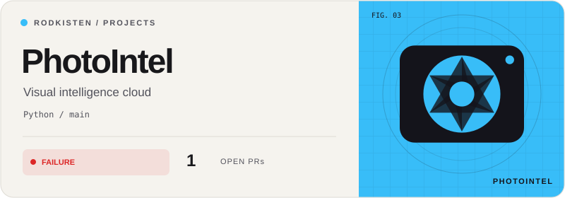
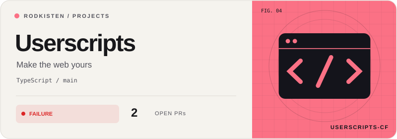

<!-- project-universe:start -->

## Project Universe

A living dashboard of public projects. CI reflects recent default-branch workflows; preview links require successful GitHub deployments.

<a href="https://github.com/rodkisten/orb"><picture><source media="(prefers-color-scheme: dark)" srcset="assets/projects/orb-dark.svg"></picture></a>

[Repository](https://github.com/rodkisten/orb) · [All PRs](https://github.com/rodkisten/orb/pulls) · [Actions](https://github.com/rodkisten/orb/actions) · [  Web verification · failure](https://github.com/rodkisten/orb/actions/runs/45209949856) · [  API verification · failure](https://github.com/rodkisten/orb/actions/runs/45209925198) · [  Refresh workspace lockfile · success](https://github.com/rodkisten/orb/actions/runs/45203992384)

<a href="https://github.com/rodkisten/jardim"><picture><source media="(prefers-color-scheme: dark)" srcset="assets/projects/jardim-dark.svg"></picture></a>

[Repository](https://github.com/rodkisten/jardim) · [All PRs](https://github.com/rodkisten/jardim/pulls) · [Actions](https://github.com/rodkisten/jardim/actions) · [  Prettier   Format Jardim · failure](https://github.com/rodkisten/jardim/actions/runs/45259842800) · [  Update pnpm lockfile · success](https://github.com/rodkisten/jardim/actions/runs/45256909631) · [  Jardim   main   push · success](https://github.com/rodkisten/jardim/actions/runs/44299616096) · [#24 chore deps : update all major dependency updates  major ](https://github.com/rodkisten/jardim/pull/24) · [#22 feat jardim : tempo litúrgico  santos e interface Hoje   Fé](https://github.com/rodkisten/jardim/pull/22) · [#19 fix web : share one Solid runtime to investigate blank screen after login](https://github.com/rodkisten/jardim/pull/19)

<a href="https://github.com/rodkisten/photointel"><picture><source media="(prefers-color-scheme: dark)" srcset="assets/projects/photointel-dark.svg"></picture></a>

[Live app](https://photos.migos.club/) · [Repository](https://github.com/rodkisten/photointel) · [All PRs](https://github.com/rodkisten/photointel/pulls) · [Actions](https://github.com/rodkisten/photointel/actions) · [  Cloudflare   Push   main · success](https://github.com/rodkisten/photointel/actions/runs/45062104078) · [  TypeScript environment contract · success](https://github.com/rodkisten/photointel/actions/runs/45062103964) · [  Terminal validation · success](https://github.com/rodkisten/photointel/actions/runs/45062103962) · [#257 feat ci : integrate shared Rod format and lint workflows](https://github.com/rodkisten/photointel/pull/257)

<a href="https://github.com/rodkisten/userscripts-cf"><picture><source media="(prefers-color-scheme: dark)" srcset="assets/projects/userscripts-cf-dark.svg"></picture></a>

[Repository](https://github.com/rodkisten/userscripts-cf) · [All PRs](https://github.com/rodkisten/userscripts-cf/pulls) · [Actions](https://github.com/rodkisten/userscripts-cf/actions) · [  Rod AST   Fixture  diff   typecheck · success](https://github.com/rodkisten/userscripts-cf/actions/runs/45385443004) · [   AST Function   Debt Audit · success](https://github.com/rodkisten/userscripts-cf/actions/runs/45385442833) · [  Menu Interativo   PR #140  perf/bundle-diet-runtime-features  · success](https://github.com/rodkisten/userscripts-cf/actions/runs/45385442710) · [#140 perf runtime : Bundle Diet phase 1   capability-gated  vanilla and host-owned runtimes](https://github.com/rodkisten/userscripts-cf/pull/140) · [#138 RFC: lazy userscript modules and code splitting](https://github.com/rodkisten/userscripts-cf/pull/138) · [#135   feat: scoped  / and  / aliases across userscripts](https://github.com/rodkisten/userscripts-cf/pull/135)

<a href="https://github.com/rodkisten/shell"><picture><source media="(prefers-color-scheme: dark)" srcset="assets/projects/shell-dark.svg"></picture></a>

[Live app](https://shell.migos.club/) · [Repository](https://github.com/rodkisten/shell) · [All PRs](https://github.com/rodkisten/shell/pulls) · [Actions](https://github.com/rodkisten/shell/actions) · [Cloudflare PR Preview · success](https://github.com/rodkisten/shell/actions/runs/45385301434) · [ShellConductor CI   27/merge · success](https://github.com/rodkisten/shell/actions/runs/45356065116) · [  Shell Flow WASM · success](https://github.com/rodkisten/shell/actions/runs/45356063785) · [#27 refactor ci : migrate dependency synchronization to shared Actions](https://github.com/rodkisten/shell/pull/27) · [#26 feat flow : node-scoped variable inspection and evaluation](https://github.com/rodkisten/shell/pull/26) · [#23 feat ci : integrate shared Rod format and lint workflows](https://github.com/rodkisten/shell/pull/23)

<a href="https://github.com/rodkisten/ast-explorer"><picture><source media="(prefers-color-scheme: dark)" srcset="assets/projects/ast-explorer-dark.svg"></picture></a>

[Live app](https://ast-explorer.dev/) · [Repository](https://github.com/rodkisten/ast-explorer) · [All PRs](https://github.com/rodkisten/ast-explorer/pulls) · [Actions](https://github.com/rodkisten/ast-explorer/actions) · [Unit Test · failure](https://github.com/rodkisten/ast-explorer/actions/runs/45062367180) · [Formatting Check · failure](https://github.com/rodkisten/ast-explorer/actions/runs/45062367001) · [Cloudflare AST Explorer · failure](https://github.com/rodkisten/ast-explorer/actions/runs/45062366915) · [#4 feat editor : integrate CodeMirror 6 provider](https://github.com/rodkisten/ast-explorer/pull/4)

<a href="https://github.com/rodkisten/rodtui"><picture><source media="(prefers-color-scheme: dark)" srcset="assets/projects/rodtui-dark.svg"></picture></a>

[Repository](https://github.com/rodkisten/rodtui) · [All PRs](https://github.com/rodkisten/rodtui/pulls) · [Actions](https://github.com/rodkisten/rodtui/actions) · [CI · failure](https://github.com/rodkisten/rodtui/actions/runs/45018597725)

<a href="https://github.com/rodkisten/eita"><picture><source media="(prefers-color-scheme: dark)" srcset="assets/projects/eita-dark.svg"></picture></a>

[Repository](https://github.com/rodkisten/eita) · [All PRs](https://github.com/rodkisten/eita/pulls) · [Actions](https://github.com/rodkisten/eita/actions) · [  Eita   Build   Release · failure](https://github.com/rodkisten/eita/actions/runs/45051346211) · [  Eita   Build   Release · success](https://github.com/rodkisten/eita/actions/runs/44848981274) · [Rust   validate · success](https://github.com/rodkisten/eita/actions/runs/44848981257) · [#2 feat: smart auto-indexing  hierarchical Zsh completions and docs](https://github.com/rodkisten/eita/pull/2)

<a href="https://github.com/rodkisten/github"><picture><source media="(prefers-color-scheme: dark)" srcset="assets/projects/github-dark.svg"></picture></a>

[Repository](https://github.com/rodkisten/github) · [All PRs](https://github.com/rodkisten/github/pulls) · [Actions](https://github.com/rodkisten/github/actions) · [  Validate TypeScript Actions · success](https://github.com/rodkisten/github/actions/runs/45385595579) · [  Validate TypeScript Actions · success](https://github.com/rodkisten/github/actions/runs/45379425843) · [   main    feat preview-report : link dashboard resources and bound comment size · success](https://github.com/rodkisten/github/actions/runs/45379425838) · [#13 Bundle Intelligence 2.0: consumer integration and hardening](https://github.com/rodkisten/github/pull/13) · [#11 fix build : publish standalone formatter and report bundles](https://github.com/rodkisten/github/pull/11)

<a href="https://github.com/rodkisten/ejc"><picture><source media="(prefers-color-scheme: dark)" srcset="assets/projects/ejc-dark.svg"></picture></a>

[Repository](https://github.com/rodkisten/ejc) · [All PRs](https://github.com/rodkisten/ejc/pulls) · [Actions](https://github.com/rodkisten/ejc/actions) · [#46 chore: Configure Renovate](https://github.com/rodkisten/ejc/pull/46)

<!-- project-universe:end -->

---

# Code Pretty Offline PWA

Deploy these files at the root of your GitHub Pages site:

- `index.html`
- `sw.js`
- `manifest.webmanifest`

## URL inputs

Open remote raw code:

```txt
https://your-user.github.io/your-repo/?url=https%3A%2F%2Fraw.githubusercontent.com%2Fuser%2Frepo%2Fmain%2Ffile.ts&lang=typescript
```

Open code embedded in URL:

```txt
https://your-user.github.io/your-repo/#lang=zsh&b64=<base64url>
```

Inside the app, use **Code URL** to generate this URL automatically.

## Offline

Open the site once online. The Service Worker caches the app shell and CDN modules. Then open again from Safari Home Screen while offline.
