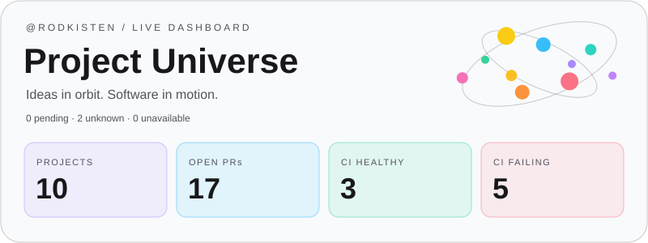
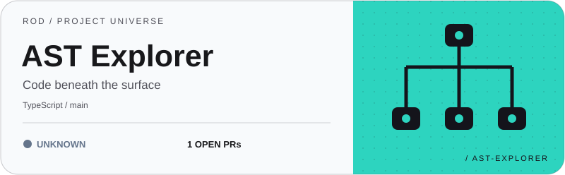

<!-- project-universe:start -->

## Project Universe

<picture><source media="(prefers-color-scheme: dark)" srcset="assets/projects/universe-dark.svg"></picture>

A living dashboard of public projects. CI reflects recent default-branch workflows; preview links require successful GitHub deployments.

<a href="https://github.com/rodkisten/orb"><picture><source media="(prefers-color-scheme: dark)" srcset="assets/projects/orb-dark.svg"></picture></a>

[Repository](https://github.com/rodkisten/orb) · [All PRs](https://github.com/rodkisten/orb/pulls) · [Issues](https://github.com/rodkisten/orb/issues) · [Actions](https://github.com/rodkisten/orb/actions)

**Pull requests:** rodkisten/orb#4

**Recent workflows:** [🪐 API verification · success](https://github.com/rodkisten/orb/actions/runs/45732469946) · [🪐 ORB · PR preview · success](https://github.com/rodkisten/orb/actions/runs/45732469867) · [🪐 Web verification · success](https://github.com/rodkisten/orb/actions/runs/45732469835)

<a href="https://github.com/rodkisten/jardim"><picture><source media="(prefers-color-scheme: dark)" srcset="assets/projects/jardim-dark.svg"></picture></a>

[Repository](https://github.com/rodkisten/jardim) · [All PRs](https://github.com/rodkisten/jardim/pulls) · [Issues](https://github.com/rodkisten/jardim/issues) · [Actions](https://github.com/rodkisten/jardim/actions)

**Pull requests:** rodkisten/jardim#30 · rodkisten/jardim#25 · rodkisten/jardim#24

**Recent workflows:** [🌱 Jardim · 30/merge · pull\_request · success](https://github.com/rodkisten/jardim/actions/runs/45665957961) · [🌻 Jardim · PR preview · success](https://github.com/rodkisten/jardim/actions/runs/45665957888) · [🌱 Jardim · main · push · success](https://github.com/rodkisten/jardim/actions/runs/45636264347)

<a href="https://github.com/rodkisten/photointel"><picture><source media="(prefers-color-scheme: dark)" srcset="assets/projects/photointel-dark.svg"></picture></a>

[Live app](https://photos.migos.club/) · [Repository](https://github.com/rodkisten/photointel) · [All PRs](https://github.com/rodkisten/photointel/pulls) · [Issues](https://github.com/rodkisten/photointel/issues) · [Actions](https://github.com/rodkisten/photointel/actions)

**Pull requests:** rodkisten/photointel#257

**Recent workflows:** [🧪 CI · PR #257 · pull\_request · success](https://github.com/rodverse/rodverse/actions/runs/45490448036) · [Cloudflare PR preview · success](https://github.com/rodverse/rodverse/actions/runs/45490447564) · [📦 Lockfiles · PR #257 · failure](https://github.com/rodverse/rodverse/actions/runs/45490447527)

<a href="https://github.com/rodkisten/userscripts-cf"><picture><source media="(prefers-color-scheme: dark)" srcset="assets/projects/userscripts-cf-dark.svg"></picture></a>

[Repository](https://github.com/rodkisten/userscripts-cf) · [All PRs](https://github.com/rodkisten/userscripts-cf/pulls) · [Issues](https://github.com/rodkisten/userscripts-cf/issues) · [Actions](https://github.com/rodkisten/userscripts-cf/actions)

**Pull requests:** rodkisten/userscripts-cf#138 · rodkisten/userscripts-cf#135

**Recent workflows:** [🧪 US · Validate & Preview · 149 · success](https://github.com/rodkisten/userscripts-cf/actions/runs/45731751648) · [🧪 US · Validate & Preview · main · failure](https://github.com/rodkisten/userscripts-cf/actions/runs/45731751428) · [🧩 US · 📦 Import ZIPs → PR · failure](https://github.com/rodkisten/userscripts-cf/actions/runs/45731751217)

<a href="https://github.com/rodkisten/shell"><picture><source media="(prefers-color-scheme: dark)" srcset="assets/projects/shell-dark.svg"></picture></a>

[Live app](https://shell.migos.club/) · [Repository](https://github.com/rodkisten/shell) · [All PRs](https://github.com/rodkisten/shell/pulls) · [Issues](https://github.com/rodkisten/shell/issues) · [Actions](https://github.com/rodkisten/shell/actions)

**Pull requests:** rodkisten/shell#28 · rodkisten/shell#23 · rodkisten/shell#22

**Recent workflows:** [🔒 Lockfile · feat/code-workflow-studio · success](https://github.com/rodkisten/shell/actions/runs/45718850386) · [💻 SH · Federation · success](https://github.com/rodkisten/shell/actions/runs/45718850360) · [ShellConductor CI · main · failure](https://github.com/rodkisten/shell/actions/runs/45671053621)

<a href="https://github.com/rodkisten/ast-explorer"><picture><source media="(prefers-color-scheme: dark)" srcset="assets/projects/ast-explorer-dark.svg"></picture></a>

[Repository](https://github.com/rodkisten/ast-explorer) · [All PRs](https://github.com/rodkisten/ast-explorer/pulls) · [Issues](https://github.com/rodkisten/ast-explorer/issues) · [Actions](https://github.com/rodkisten/ast-explorer/actions)

**Pull requests:** rodkisten/ast-explorer#5 · rodkisten/ast-explorer#4

**Recent workflows:** [🌳 AST · Unit Test · failure](https://github.com/rodkisten/ast-explorer/actions/runs/45487557738) · [🌳 AST · Formatting Check · failure](https://github.com/rodkisten/ast-explorer/actions/runs/45487556772) · [🌳 AST · Cloudflare AST Explorer · success](https://github.com/rodkisten/ast-explorer/actions/runs/45487556753)

<a href="https://github.com/rodkisten/rodtui"><picture><source media="(prefers-color-scheme: dark)" srcset="assets/projects/rodtui-dark.svg"></picture></a>

[Repository](https://github.com/rodkisten/rodtui) · [All PRs](https://github.com/rodkisten/rodtui/pulls) · [Issues](https://github.com/rodkisten/rodtui/issues) · [Actions](https://github.com/rodkisten/rodtui/actions)

**Pull requests:** rodkisten/rodtui#2

**Recent workflows:** [🦀 Release: Manual · main · failure](https://github.com/rodkisten/rodtui/actions/runs/45603469268) · [🦀 CI: main · Update release.yml · failure](https://github.com/rodkisten/rodtui/actions/runs/45603437246) · [CI · failure](https://github.com/rodkisten/rodtui/actions/runs/45600959201)

<a href="https://github.com/rodkisten/eita"><picture><source media="(prefers-color-scheme: dark)" srcset="assets/projects/eita-dark.svg"></picture></a>

[Repository](https://github.com/rodkisten/eita) · [All PRs](https://github.com/rodkisten/eita/pulls) · [Issues](https://github.com/rodkisten/eita/issues) · [Actions](https://github.com/rodkisten/eita/actions)

**Pull requests:** rodkisten/eita#2

**Recent workflows:** [📦 Eita · Build & Release · failure](https://github.com/rodkisten/eita/actions/runs/45051346211) · [📦 Eita · Build & Release · success](https://github.com/rodkisten/eita/actions/runs/44848981274) · [Rust · validate · success](https://github.com/rodkisten/eita/actions/runs/44848981257)

<a href="https://github.com/rodkisten/github"><picture><source media="(prefers-color-scheme: dark)" srcset="assets/projects/github-dark.svg"></picture></a>

[Repository](https://github.com/rodkisten/github) · [All PRs](https://github.com/rodkisten/github/pulls) · [Issues](https://github.com/rodkisten/github/issues) · [Actions](https://github.com/rodkisten/github/actions)

**Pull requests:** rodkisten/github#11

**Recent workflows:** [🧪 Validate TypeScript Actions · success](https://github.com/rodkisten/github/actions/runs/45732417536) · [🚀 \[main\] · fix(app-token): forward workflows permission \[deploy\] · success](https://github.com/rodkisten/github/actions/runs/45732413981) · [🔐 Dependency audit · success](https://github.com/rodkisten/github/actions/runs/45701868031)

<a href="https://github.com/rodkisten/ejc"><picture><source media="(prefers-color-scheme: dark)" srcset="assets/projects/ejc-dark.svg"></picture></a>

[Repository](https://github.com/rodkisten/ejc) · [All PRs](https://github.com/rodkisten/ejc/pulls) · [Issues](https://github.com/rodkisten/ejc/issues) · [Actions](https://github.com/rodkisten/ejc/actions)

**Pull requests:** rodkisten/ejc#46

<!-- project-universe:end -->

---

# Code Pretty Offline PWA

Deploy these files at the root of your GitHub Pages site:

- `index.html`
- `sw.js`
- `manifest.webmanifest`

## URL inputs

Open remote raw code:

```txt
https://your-user.github.io/your-repo/?url=https%3A%2F%2Fraw.githubusercontent.com%2Fuser%2Frepo%2Fmain%2Ffile.ts&lang=typescript
```

Open code embedded in URL:

```txt
https://your-user.github.io/your-repo/#lang=zsh&b64=<base64url>
```

Inside the app, use **Code URL** to generate this URL automatically.

## Offline

Open the site once online. The Service Worker caches the app shell and CDN modules. Then open again from Safari Home Screen while offline.
